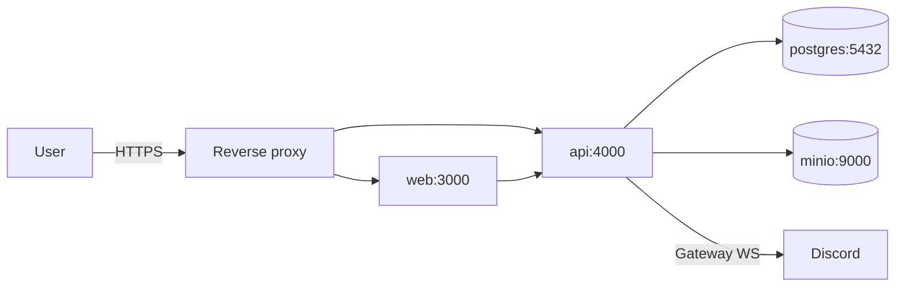

# Deployment

## Goal

After copying `.env.example` to `.env` and generating a unique `SESSION_SECRET`, a new installation must start with:

```bash
docker compose up -d
```

The stack contains `web` (Next.js), `api` (Fastify, worker, and optional bot), `postgres` (PostgreSQL 16), and `minio` (S3-compatible object storage).

## Topology



A reverse proxy is optional during development. Production deployments should use Caddy, Traefik, or Nginx with TLS. Only the proxy, web, and API should be publicly reachable; PostgreSQL and MinIO belong on the private Docker network.

## Services and volumes

| Service    | Image                        | Persistent volume |
| ---------- | ---------------------------- | ----------------- |
| `postgres` | `postgres:16-alpine`         | `pgdata`          |
| `minio`    | `minio/minio`                | `miniodata`       |
| `api`      | Local build or release image | None; stateless   |
| `web`      | Local build or release image | None; stateless   |

## Environment variables

See [`.env.example`](../.env.example). The critical groups are:

- `DATABASE_URL` and `DATABASE_URL_DOCKER`: PostgreSQL connections from the host and Compose network.
- `SESSION_SECRET`: a unique secret generated with `openssl rand -hex 32`.
- `S3_*`: object-storage endpoint, bucket, and credentials.
- `DISCORD_*`: optional OAuth and bot configuration.
- `SMTP_*`: optional email delivery configuration.
- `SEED_DEMO_DATA`: opt-in demo seed; disabled by default.

## Migrations and seed data

The API applies Drizzle migrations during startup before accepting traffic. The demo seed is idempotent and runs only when `SEED_DEMO_DATA=true`.

## Health checks

- API: `GET /healthz`, including PostgreSQL connectivity.
- Web: `GET /`.
- Compose checks PostgreSQL, MinIO, API, and web and waits for healthy dependencies before starting each dependent service.

## Backups

- PostgreSQL: schedule `pg_dump` with an appropriate retention policy.
- MinIO: mirror the bucket with `mc mirror` or back up its volume.
- Test restoration periodically by following [SELF_HOSTING.md](SELF_HOSTING.md).

## Updating an installation

1. Read the changelog and release notes.
2. Back up PostgreSQL and object storage.
3. Update the pinned image tags or local checkout.
4. Run `docker compose pull` when using release images.
5. Run `docker compose up -d`; startup applies migrations.
6. Verify health checks and one public tournament route.

## CI/CD workflows

GitHub Actions provides:

- **CI (push and pull request):** lint, type checking, unit and integration tests, build, `pnpm audit`, and Playwright with PostgreSQL.
- **CodeQL:** JavaScript and TypeScript static analysis.
- **Compose clean-install smoke (manual):** creates an isolated configuration, builds and starts the full stack, checks health routes, and removes its volumes.
- **Publish container images (version tags):** a `vX.Y.Z` tag builds API and web images for AMD64 and ARM64, publishes semantic-version tags to GHCR, attaches an SBOM and verifiable provenance, and creates a GitHub Release after both images succeed.
- **OWASP ZAP baseline (manual):** starts an isolated stack, passively scans the public web application, and stores the report without automatically opening issues.

GHCR packages used for public releases must have public visibility.

### Publishing a release

1. Confirm that CI, CodeQL, the Compose smoke test, and the ZAP baseline pass on `main`.
2. Update versions and `CHANGELOG.md`; check the pull request labels used by `.github/release.yml`.
3. Create and push an annotated tag:
   ```bash
   git tag -a vX.Y.Z -m "OpenTournament vX.Y.Z"
   git push origin vX.Y.Z
   ```
4. Wait for **Publish container images**. If the tag push cannot trigger Actions, run the workflow manually with the existing `vX.Y.Z` tag; it validates the tag and builds that exact checkout.
5. Verify that `opentournament-api` and `opentournament-web` are public in GHCR and test an installation with the exact published tags.

## Capacity reference

| Scenario                         | Suggested resources          |
| -------------------------------- | ---------------------------- |
| Minimum, 8–32 participants       | 2 vCPU, 2 GB RAM, 20 GB disk |
| Typical, 128 participants        | 2 vCPU, 4 GB RAM, 40 GB disk |
| Load smoke, 256 concurrent users | 4 vCPU, 8 GB RAM             |

## Low-cost deployment direction

A future managed instance may run on a small VPS or low-cost container provider with R2-compatible storage. The project remains provider-independent and relies on commodity PostgreSQL and S3-compatible infrastructure.

## Tournament experience operations

### Public origins and reverse proxy

Set `APP_URL` to the canonical HTTPS web origin and `API_URL` to the canonical API origin. In the supplied Compose topology, the reverse proxy is the only public entry point; keep PostgreSQL and MinIO bound to the private network. The web app uses its `/api/v1` rewrite, so terminate TLS at the proxy and forward `/api/v1/*` to the API without rewriting paths or stripping `Cookie`, `Set-Cookie`, `Origin`, `X-CSRF-Token`, or `Last-Event-ID` headers. Do not cache authenticated responses.

The API permits credentialed CORS only from `APP_URL` outside development. Configure the proxy's host and forwarded-protocol headers consistently with those two variables; a mismatched public origin causes browser session and CORS failures. Keep `SESSION_SECRET`, PostgreSQL passwords, `S3_SECRET_KEY`, SMTP credentials, and Discord secrets outside Git and rotate defaults before exposure.

### Media, profiles, and publication lifecycle

Use `S3_ENDPOINT_DOCKER` for the API-to-object-store address and `S3_ENDPOINT` for host tooling; retain `S3_BUCKET`, `S3_ACCESS_KEY`, `S3_SECRET_KEY`, and `S3_FORCE_PATH_STYLE` consistently. Back up both `pgdata` and `miniodata`: PostgreSQL holds media metadata and publication state, while MinIO holds the bytes. API startup applies Drizzle migrations before traffic; do not run more than one migration authority at a time.

Public pages must use same-origin opaque media URLs only: `/api/v1/media/:id`. Do not expose object keys, bucket URLs, MinIO console URLs, or presigned storage URLs in HTML, CSS, OBS scenes, or logs. The API authorizes the media proxy from the current publication state. Revoke tournament/profile public delivery through their supported publication and visibility controls; never make the bucket public.

Media responses use `Cache-Control: public, max-age=31536000, immutable`. A revocation can return `404` from a fresh origin request or cache bypass while an already-cached browser/proxy copy continues to serve its immutable bytes. When immediate removal of cached bytes is required, purge the relevant operational cache; no application setting can retroactively erase copies already cached by clients.

Verify public delivery after a migration or deploy:

1. Sign in as the owner, create or update the profile/tournament appearance, and confirm owner routes still require the session.
2. Publish a tournament and verify `/t/:slug`, `/players/:slug`, and `/api/v1/media/:id` through the public origin.
3. Revoke public publication/visibility and verify fresh origin requests or a cache bypass return `404`; purge operational caches when immediate cached-byte removal is required.
4. Confirm object storage remains private and that application traffic reaches it only through the API.

### Overlay and SSE proxy behavior

OBS browser sources use `/t/:slug/overlay/:view` with `scoreboard`, `up-next`, or `champion` as `:view`. Set the browser-source canvas to **1920x1080** and preserve transparency: do not add a proxy background, HTML background, or cache transformation that flattens alpha. This task documents deployment behavior only; task 6.3 owns OBS/CEF smoke recording.

Overlay updates stream from `/api/v1/events/public?tournament=:id`. Realtime channels are process-local: all tournament/media mutations and SSE clients must share exactly one API process unless shared fan-out/replay is added; sticky SSE alone is insufficient. Proxy it as SSE: disable buffering and response caching, allow long-lived connections, preserve `text/event-stream`, `Cache-Control: no-cache, no-store, must-revalidate, no-transform`, and `Last-Event-ID`, and do not gzip/buffer the stream. Clients reconnect and refetch authoritative state after disconnects; a proxy timeout or restart must therefore permit reconnect rather than returning a cached event snapshot.

### Bounded operational verification and troubleshooting

- Run `docker compose up -d`, then check `GET /healthz`, `GET /`, and a published public tournament route through the proxy.
- Check API logs for migration, S3, CORS, or session-origin errors; check proxy logs for stripped cookies/CSRF headers, upstream timeouts, or buffered SSE.
- For unexpected public media access, verify publication/revocation state first, then confirm the requested URL is `/api/v1/media/:id` and MinIO is not publicly exposed.
- For stale overlays, verify the API instance count, SSE response headers, proxy buffering/timeout settings, and reconnect/refetch behavior before clearing browser caches.
- Roll back application images only with matching database compatibility, keep backups, and verify revocation behavior again after rollback.

### OBS Browser Source smoke record (2026-09-04)

A real local OBS Browser Source smoke ran against the disposable isolated runtime, rather than Playwright. OBS was controlled through its local `obs-websocket` API and each visual assertion used `GetSourceScreenshot` on the actual `browser_source` input named `Overlay Browser`.

- **Build evidence:** OBS 32.0.4 on Windows; `obs-websocket` 5.6.3; `obs-browser` 2.26.3 with CEF runtime 127.0.6533.120.
- **Canvas and transparency:** OBS queried the source as 1920×1080 with `html, body { background: transparent; margin: 0; overflow: hidden; }`. Source screenshots were 1920×1080 and retained 2,059,753–2,060,037 fully transparent pixels plus 5,131–5,132 fully opaque rendered pixels across the named views.
- **Authoritative bootstrap:** Browser Source loaded the public `scoreboard`, `up-next`, and `champion` routes for one isolated published tournament. Distinct source screenshot SHA-256 values were `97b2c906…d7333`, `18d526ed…c3025`, and `c6b827f5…df7b2`, respectively.
- **Live refresh:** replacing the published logo through the authorized application route changed the scoreboard source screenshot from `97b2c906…d7333` to `d13870bf…3189d` after the public invalidation/refetch path. The authoritative overlay response returned `Cache-Control: no-cache, no-store, must-revalidate`.
- **Reconnect:** after stopping and restarting only the isolated API process, the source retained the last rendered snapshot while unavailable, then converged after EventSource reconnect; a post-reconnect logo mutation produced source screenshot `6bbef1db…84ff0`.
- **Manual reload:** invoking the OBS Browser Source `refreshnocache` property through obs-websocket reloaded the page and converged to the then-current authoritative logo; resulting source screenshot SHA-256 was `c6a57690…010e0`.

Bounded reproduction: run one API process and one web process against isolated PostgreSQL/MinIO; publish a tournament with a logo; configure an OBS Browser Source at `http://localhost:<web-port>/t/<slug>/overlay/<scoreboard|up-next|champion>` with a 1920×1080 transparent canvas; use source screenshots (not display capture) to check bootstrap, an authorized appearance mutation, API restart/reconnect, and `refreshnocache`. Keep the object store private and do not use an external storage URL.
